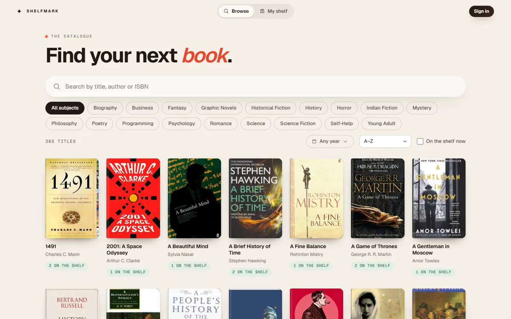
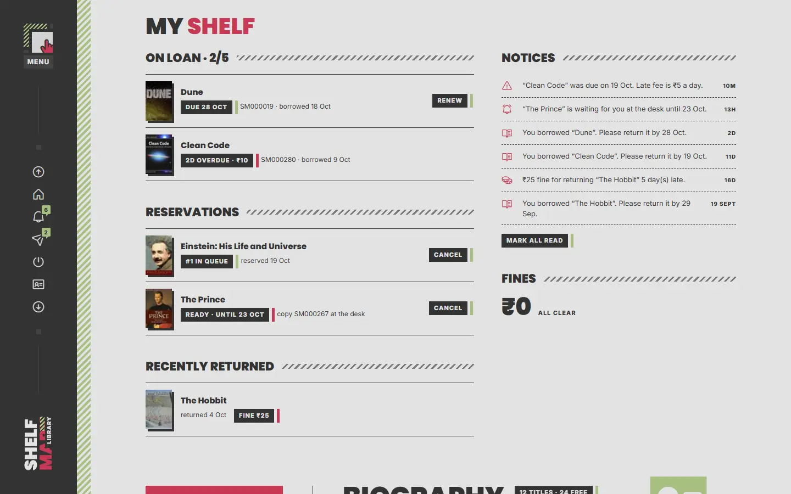
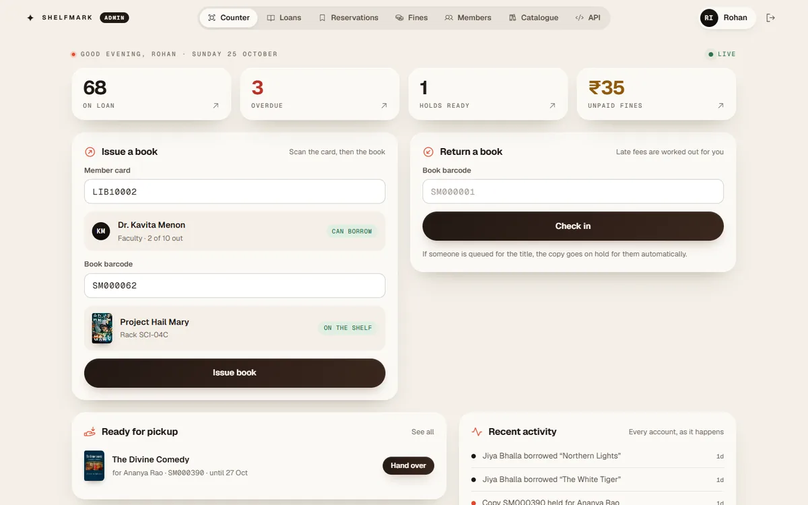
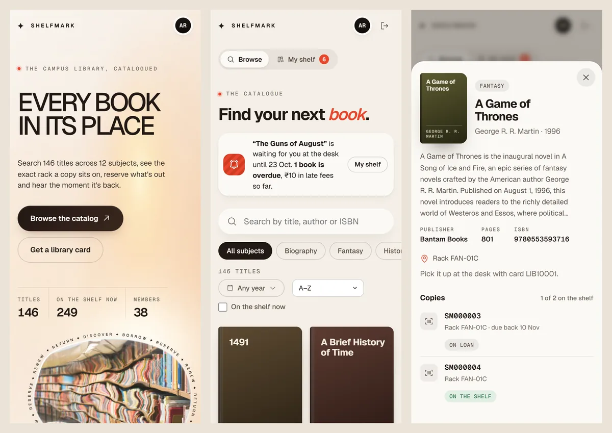
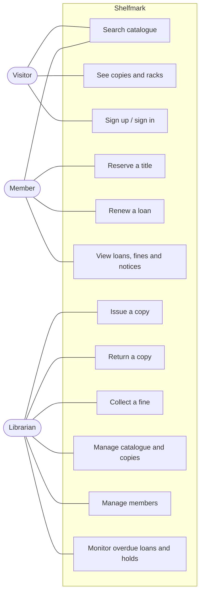
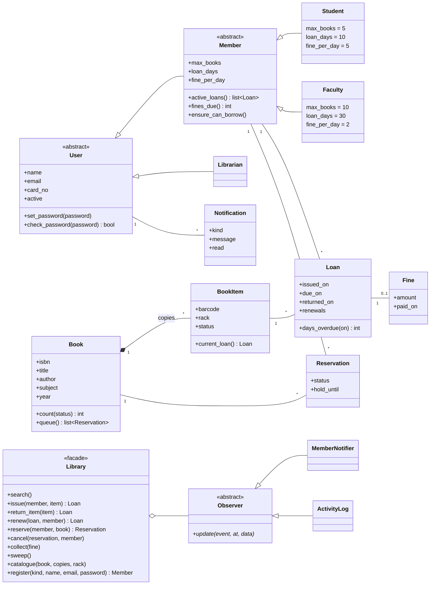
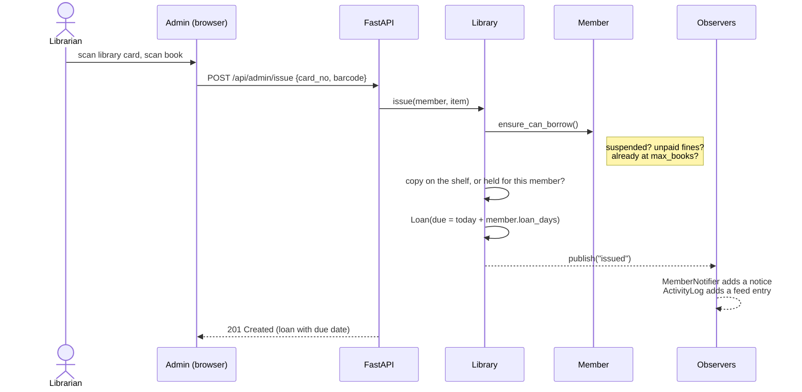
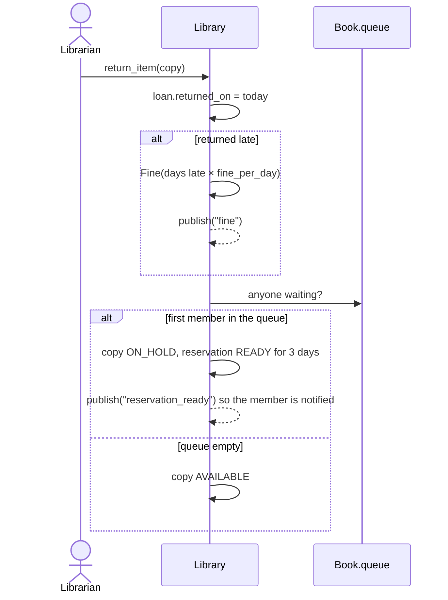
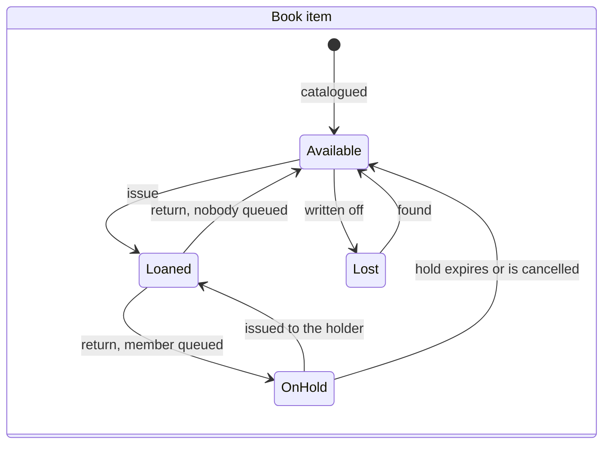
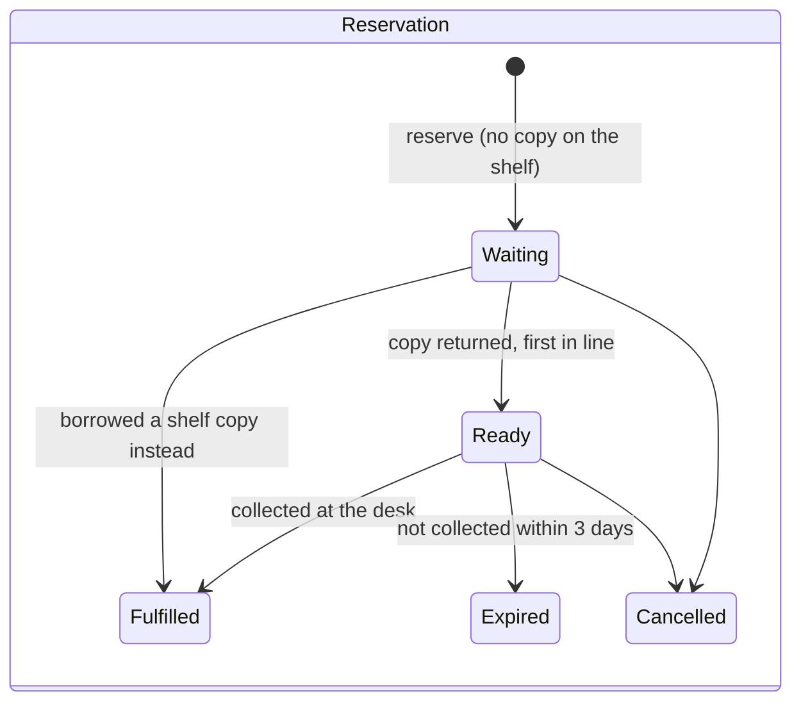

# Shelfmark

A small but complete **library management system**, built as an Object-Oriented Software Development case study. It is two apps on one database:

- **Shelfmark** for students and faculty: search the catalogue, reserve titles that are out, renew loans and keep track of fines and notices.
- **Shelfmark Admin** for library staff: issue and return copies by barcode, collect fines, and manage the catalogue and memberships.

**Live demo:** <https://shelfmark-qri1.onrender.com>

| App | Sign in at | Login | Password |
|---|---|---|---|
| Shelfmark (student) | `/catalog` | `student@shelfmark.test` or card `LIB10001` | `shelfmark` |
| Shelfmark (faculty) | `/catalog` | `faculty@shelfmark.test` or card `LIB10002` | `shelfmark` |
| Shelfmark Admin (librarian) | `/admin` | staff ID `STAFF001` | `shelfmark-admin` |

Members and staff sign in at separate doors with separate sessions, so both apps can be open side by side in one browser. The interactive API docs at `/docs` are for signed-in staff only.


## What it does

**Visitors** can browse the landing page, which shows live catalogue figures, the most borrowed titles and the subject shelves. They can search the catalogue by title, author, ISBN, subject and publication year, and see every copy of a title with its rack and status.

**Members** (Student or Faculty) use Shelfmark to:
- sign up and get a library card with a barcode, then sign in with their email or card number;
- reserve a title when every copy is out, joining a first-come, first-served queue;
- renew a loan once, provided it isn't overdue and nobody is queued for it;
- see their loans, due dates, accruing late fees, holds, fines and notices on *My shelf*.

**Librarians** sign in to Shelfmark Admin with their staff ID. It opens on the counter:
- issue and return side by side: scan a library card and a book's barcode, see who and what before confirming (USB scanners work as keyboards);
- four live counts (on loan, overdue, holds ready, unpaid fines), holds to hand over in one click, the overdue list and an activity feed from every account that refreshes itself;
- tabs for loans, reservations, fines, members (register, suspend, reinstate, see a card's recent activity) and the catalogue (with an Open Library ISBN lookup when adding titles).

| Shelfmark: the catalog | Shelfmark: my shelf |
|---|---|
|  |  |
| **Shelfmark Admin** | **On a phone** |
|  |  |

## Case study requirements

| Requirement | How Shelfmark meets it |
|---|---|
| Search books by title, author, subject category and publication date | `GET /api/books?q=&by=title\|author\|isbn&subject=&year_from=&year_to=` |
| Every book has a unique identifier and a rack number to locate it | ISBN on `Book`; a barcode and rack (e.g. `FAN-01A`) on every `BookItem` |
| More than one copy of a book (*book items*) | `Book 1 ── * BookItem`; copies can be added, written off and found again |
| Who has a particular book, and what a member has borrowed | Admin → Loans (search by member, card, title or barcode), member cards, copy scans |
| Maximum books per member | Students 5, faculty 10 (`Member.max_books`) |
| Maximum days a book can be kept | Students 10 days, faculty 30 (`Member.loan_days`), one renewal |
| Fines for late returns | On return: days late × daily rate (₹5 student, ₹2 faculty); unpaid fines block borrowing |
| Reserve books that aren't available | Reservation queue per title; the returned copy is held for 3 days for the first in line |
| Notify when a reserved book is available, or a book is overdue | `MemberNotifier` observer posts in-app notices |
| Barcodes on books and library cards | Every copy has a barcode (`SM000123`), every member card a CODE128 barcode; the Admin counter works with USB scanners |

## Object-oriented design

### Use cases



### Class diagram



### Design patterns and principles

| Pattern | Where | Why |
|---|---|---|
| **Inheritance & polymorphism** | `User → Member → Student / Faculty`, `Librarian` in [`app/models.py`](app/models.py) | Limits, loan period and fine rate are class attributes, so rules ask `member.max_books` instead of switching on a type code. Adding a membership type is a new subclass. |
| **Facade** | `Library` in [`app/library.py`](app/library.py) | One entry point for every use case. The HTTP layer stays thin and the rules are testable without a web server. |
| **Observer** | `Observer` → `MemberNotifier`, `ActivityLog` | Circulation code publishes events (`issued`, `fine`, `reservation_ready`…); notices and the audit feed subscribe without the domain knowing about them. |
| **Factory** | `MEMBER_TYPES` + `Library.register(kind, …)` | The requested membership type chooses which `Member` subclass is created. |
| **Encapsulation** | `Member.ensure_can_borrow()`, `Book.queue`, `Loan.days_overdue()` | Invariants live with the data they protect. |
| **Unit of Work / ORM mapping** | SQLAlchemy `Session`, single-table inheritance on `users.role` | The class hierarchy maps onto one table, and each request commits or rolls back as a unit. |

### Issuing a book



### Returning a book



### Lifecycles





Time-based rules (overdue notices and expired holds) are applied by `Library.sweep()`. It runs when the Admin counter or a member's shelf is loaded, so no scheduler is needed for a single-instance deployment.

## Architecture

```
Browser ── landing · Shelfmark (catalog) · Shelfmark Admin (HTML, CSS, vanilla JS)
   │  JSON over HTTPS, session cookie
FastAPI (app/main.py) ── validation, auth guards, JSON shapes
   │
Library facade (app/library.py) ── use cases, observers
   │
Domain model (app/models.py) ── entities and rules, mapped with SQLAlchemy
   │
PostgreSQL on Neon in production · SQLite locally
```

```
app/
  models.py     entities, inheritance hierarchy, business rules
  library.py    Library facade + observers (notifications, activity feed)
  main.py       REST API, auth, static pages
  seed.py       demo data, replayed through the Library facade
  db.py         engine and session setup
web/            landing (index), catalog and admin pages on one shared theme.css and shared.js
data/books.json 365 curated titles, details from Open Library
web/covers/     their front covers, one JPEG per ISBN
scripts/        dataset builder
tests/          unit tests for every business rule
```

- **Backend:** Python 3.13, FastAPI, SQLAlchemy 2, psycopg 3
- **Auth:** scrypt-hashed passwords; members and staff sign in at separate endpoints into separate slots of one signed session cookie (`HttpOnly`, `SameSite=Lax`, `Secure` in production); role guards on every endpoint
- **Frontend:** plain HTML/CSS/JS with no build step: one theme for every page, CSS animations and page transitions, plus JsBarcode and Phosphor icons from CDNs
- **Data:** demo seed with 365 books on 18 subject shelves, 777 copies, 63 accounts and two months of simulated circulation. The simulation runs through the same `Library` class the API uses, so every loan, fine, hold and notice obeys the real rules.

## Run it locally

```bash
python -m venv .venv
.venv\Scripts\activate            # macOS/Linux: source .venv/bin/activate
pip install -r requirements.txt
uvicorn app.main:app --reload
```

Open <http://localhost:8000>. The first start creates `shelfmark.db` (SQLite) and seeds the demo data. To use Postgres instead, copy `.env.example` to `.env`, fill in `DATABASE_URL` and start with `uvicorn app.main:app --env-file .env`.

```bash
python -m unittest        # 17 tests covering the case-study rules
```

| Page | URL |
|---|---|
| Landing | `/` |
| Shelfmark (members) | `/catalog` |
| Shelfmark Admin (staff) | `/admin` |
| Interactive API docs (staff only) | `/docs` |

## Deploy

One web service on Render's free plan and one free Neon Postgres database. Nothing else to set up.

1. On [Neon](https://neon.tech), create a project and copy its **pooled** connection string.
2. Click [](https://render.com/deploy?repo=https://github.com/AarushCh/Shelfmark) and paste that string as `DATABASE_URL`. Render generates `SECRET_KEY` itself.
3. The first boot creates the tables and seeds the demo library.

## Dataset

[`scripts/fetch_books.py`](scripts/fetch_books.py) builds `data/books.json` from a curated list of 365 well-known titles across 18 subjects. Each title is enriched through the [Open Library API](https://openlibrary.org/developers/api) (CC0) with its ISBN, publisher, page count and description, and its front cover is saved from Google Books into `web/covers/`, so the site never depends on another server for images. Re-running it only fetches titles that are new or changed.

## Credits

- Interface adapted from CodePen pens (MIT) and unified into one theme: the hero is **[SVG] [CSS] Marquee Glass Bubble** by [Fernando Cohen](https://codepen.io/designfenix); the paper palette, dark tiles and pale platform come from **3D Data cards menu** by Deckard; the stat tiles, segmented filters, switches and sheets follow the **Bento element lab** by Mohammad Abu Sakour; the striped attention strip is from **HYPER LINK, a sandbox concept** by Pharaoh Leap.
- Book data: [Open Library](https://openlibrary.org). Covers: [Google Books](https://books.google.com). Photography: [Unsplash](https://unsplash.com). Icons: [Phosphor](https://phosphoricons.com). Barcodes: [JsBarcode](https://github.com/lindell/JsBarcode).
